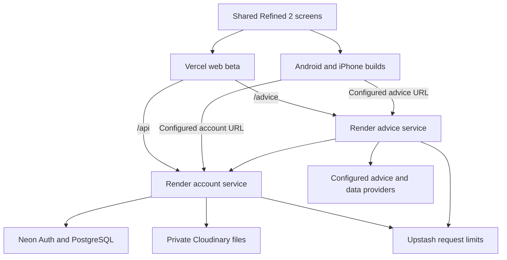
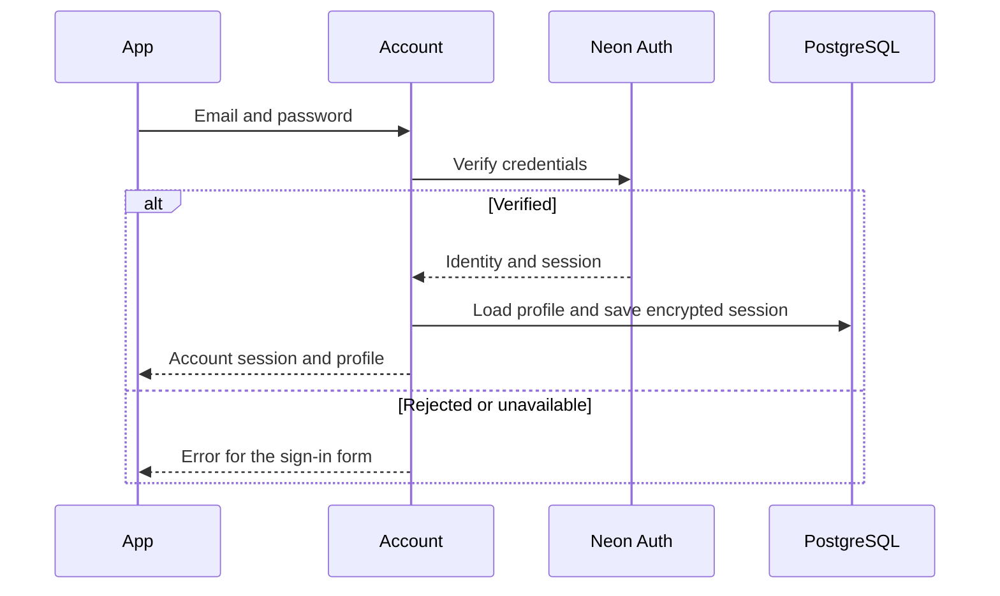
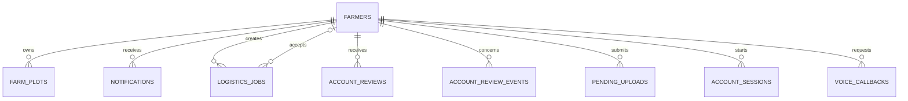

# Architecture

The native and web entry points load the same React Native screens in [App.js](MobileApp/App.js). Native builds store session tokens in platform secure storage. The browser keeps its token in session storage. The web service worker caches the interface and static files so the website can reopen offline. Account changes and fresh advice require a network connection.

The account service handles sign-in, farmer profiles, plots, transport, notifications, private uploads, and staff review. The advice service verifies identity and calls the account service when it needs farmer context. Production permits public signup and login requests. Each service enforces permission on private requests and uses Upstash to bound traffic. Database and provider credentials stay on the servers.

The [database schema](backend/src/db/schema.sql) defines farmer profiles, plots, notifications, logistics jobs, account reviews and review events, pending uploads, account sessions, revoked tokens, and voice callbacks. Consult that file for constraints and relationships.

The [OpenAPI contract](backend/openapi.json) describes HTTP requests and responses. The [route inventory](backend/api-contract.json) maps the account and advice services. Use the running handlers and contract tests to resolve differences. Clients should handle permission failures explicitly and preserve source names and dates on advice results.

The [release guide](docs/DEPLOYMENT.md) maps the builds. [Development](docs/DEVELOPMENT.md) explains how to run the services.

## Sign-in request

## Record ownership

