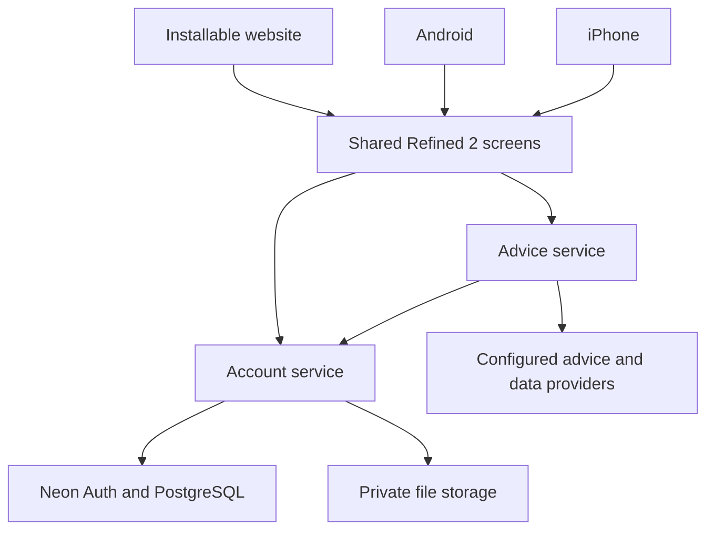
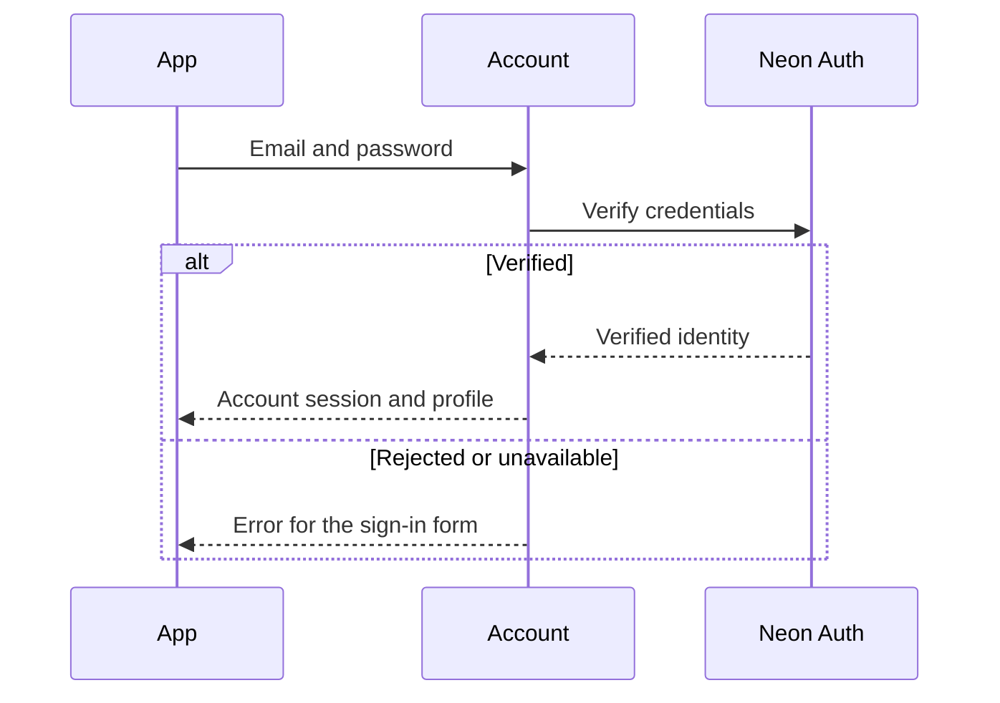
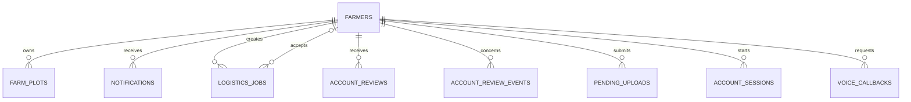

# Architecture

The native and web entry points load the same React Native screens in [App.js](MobileApp/App.js). The native app stores session tokens in platform secure storage. The browser keeps its token in session storage. The web offline worker caches the interface and static assets. Authenticated requests continue through the network.

The account service owns identity, farmer profiles, farm plots, transport, notices, private uploads, and staff review. The advice service verifies identity before serving protected requests. It uses the account service when it needs farmer context. The server remains responsible for ownership and staff decisions.

The [database schema](backend/src/db/schema.sql) defines farmer profiles, plots, notifications, logistics jobs, account reviews and review events, pending uploads, account sessions, revoked tokens, and voice callbacks. Consult that file for constraints and relationships.

The [OpenAPI contract](backend/openapi.json) describes HTTP requests and responses. The [route inventory](backend/api-contract.json) maps the account and advice services. Use the running handlers and contract tests to resolve differences. Clients should handle permission failures explicitly and preserve source names and dates on advice results.

The [release guide](docs/DEPLOYMENT.md) maps the builds. [Development](docs/DEVELOPMENT.md) explains how to run the services.

## Sign-in request

## Record ownership

