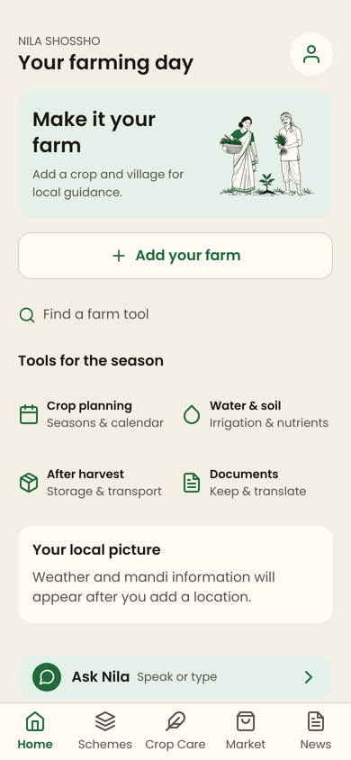
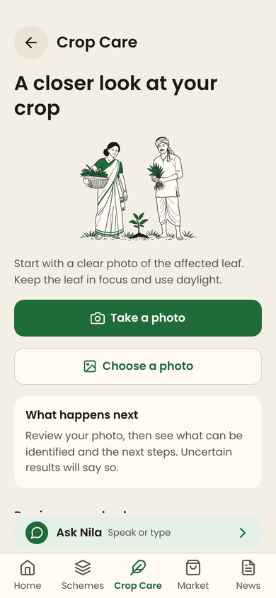
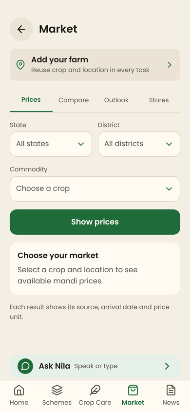
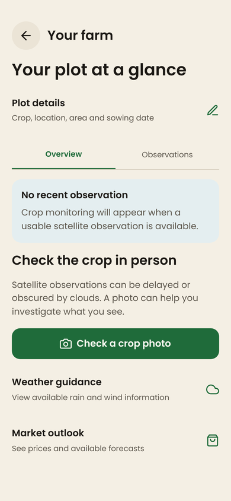

# Refined 2 design

Wonder Tarpon, Page 1, is the design authority. The shared app implements Refined 2 through [App.js](MobileApp/App.js). Review and Review study are separate design sections. Ask Nila Review belongs to Refined 2 and lets the user check transcribed words before sending.

| Area | Refined 2 screens and states | Count |
| --- | --- | --- |
| Entry | Welcome, Login, Signup, Startup Loading | 4 |
| Home and farm | Home, Home Offline, Farm Setup, Farm Monitoring | 4 |
| Market and discovery | Schemes, Market Prices, Nearby Stores, Price Comparison, Market Insights, News | 6 |
| Crop and farm tools | Cropcare, Crop Check Uncertain, Post Harvest, Water Management, Fertilizers, Crop Suggestion, Crop Calendar | 7 |
| Ask Nila | Chatbot, Ask Nila Listening, Ask Nila Review, Ask Nila Connection | 4 |
| Account | Settings, Profile, Update Profile, Language Change, Password Change, Notifications, Choose Profile Picture, Notification Preferences | 8 |
| Documents and transport | Documents, Document Translate, Logistics, Logistics Partner | 4 |

## Selected artboards

| Home | Crop Care |
| --- | --- |
|  |  |

| Market Prices | Farm Monitoring |
| --- | --- |
|  |  |

Validate each state on the installed website, Android and iPhone. Compare the shared screen first, then check the platform behavior for file picking, camera, microphone and session storage. Keep loading, empty, offline, permission and provider-failure messages visible when those states occur.

See the [user guide](docs/USER_GUIDE.md) for common journeys and the [release record](backend/RELEASE.md) for verified platforms and pending checks.
