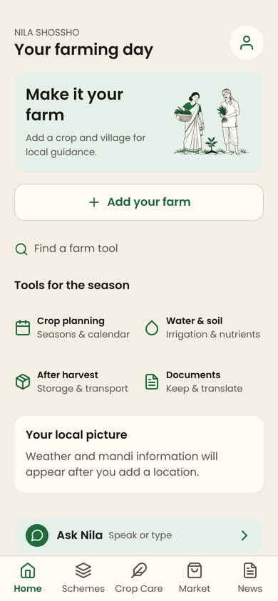
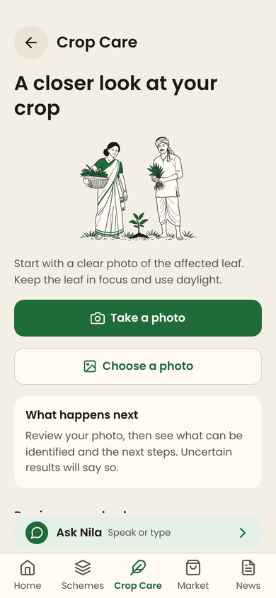

# Nila Shoshsho

Nila Shoshsho helps farmers manage plots, check weather and market information, ask crop questions, and arrange transport. The same Refined 2 screens serve the website, Android and iPhone. Staff can review accounts and documents through restricted controls.

## Design preview

 

These are design previews from Wonder Tarpon. See [Design](DESIGN.md) for more screens.

## Start here

- [Using the app](docs/USER_GUIDE.md) covers installation, everyday tasks and offline behavior.
- [Development](docs/DEVELOPMENT.md) covers local setup and test commands.
- [Architecture](ARCHITECTURE.md) maps screens, servers and stored records.
- [Design](DESIGN.md) lists the approved Refined 2 screens and platform checks.
- [Deployment](docs/DEPLOYMENT.md) covers the website and both mobile builds.
- [Release checklist and evidence](backend/RELEASE.md) records what is checked before release.

The frontend design authority is Wonder, Tarpon, Page 1, Refined 2. Use the 37 screens in that set. Design correspondence, implemented behavior and release verification are tracked independently.
