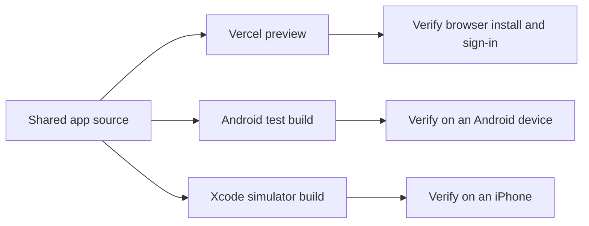

# Deploy and package

## Website on Vercel

Set the project root to `MobileApp`. [vercel.mjs](../MobileApp/vercel.mjs) sets the web build command, output directory and routes. Use Node 24. Set `ACCOUNT_API_BASE_URL` to the account HTTPS API base, including its `/api` prefix. Set `ADVICE_API_BASE_URL` to the advice HTTPS origin. Confirm the upstreams belong to the intended environment and accept requests from the configured route.

Use a preview first. Open the site, find the install option, and test a synthetic sign-in and plot journey. Then disconnect and reopen the installed website. Check that cached startup works and protected actions ask for a connection. A preview pointing to staging services needs an approved server-side path through their access gate. Keep the staging key out of the browser.

## Android

Open `MobileApp/android` in Android Studio. The build selects Android SDK 37 and NDK 27.1.12297006. For local testing, use a booted Android Virtual Device and the app development server. From `MobileApp`, run `npm run android` with the backend running for signed-in tests. For release, use Android Studio's Generate Signed Bundle flow and the owner-controlled upload key.

If Windows reports that a native filename exceeds 260 characters, build a separate copy at a short physical path. On the Android 17 emulator, allow the debug app local network access when it needs to reach the development server.

## iPhone

On a Mac, install the iOS dependencies from the checked-in [Podfile](../MobileApp/ios/Podfile). Open `MobileApp.xcworkspace` in Xcode after CocoaPods finishes. Before archiving, select the owner's developer team and the bundle identifier registered for this app. The checked-in project still uses a template identifier. Review the app's actual data collection and permission disclosures for App Store Connect. Then verify the simulator and a signed device build.

Set the public HTTPS service addresses for native release builds through `EXPO_PUBLIC_ACCOUNT_API_URL` and `EXPO_PUBLIC_ADVICE_API_URL`. These addresses are visible to users. Store private provider credentials on the servers.

Use the [release checklist](../backend/RELEASE.md) before promotion or submission.

## Release paths

