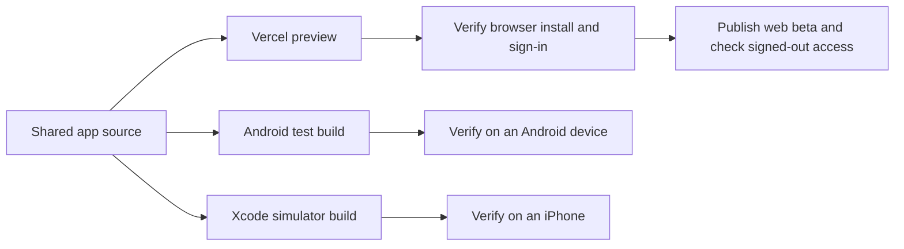

# Deploy and package

## Website on Vercel

The [public beta](https://nila-shoshsho-pwa.vercel.app/) deploys from GitHub `main`. Record the previous live deployment before publishing a new build. If the sign-in or private-route checks fail after a change, restore the last verified deployment from the Vercel dashboard.

Set the project root to `MobileApp` and use Node 24. [vercel.mjs](../MobileApp/vercel.mjs) sets the web build command, output directory and the two public Render addresses. If you replace a Render service, update its address there and verify the route on a protected Vercel preview.

The canonical Vercel project is `nila-shoshsho-pwa`. Its canonical backends are `nila-shoshsho-account-production` and `nila-shoshsho-advice-production` on Render. Keep the database, identity, voice and model credentials in Render's private settings. Use Vercel Standard Protection to keep preview URLs private while serving the production domain to customers.

Vercel project-level rules can take precedence over the routes in the repository. Keep the old staging overrides disabled on this project. Use the public address to confirm that signup and login reach the intended account service and that private routes reject signed-out requests.

Use a protected preview to check both backend routes. POST checks must come from an origin allowed by Render. Use an isolated environment and a synthetic account for sign-in and tests that save records. Open the site, find the install option, and test sign-in and saving a plot. Then disconnect and reopen the installed website. Check that the app opens offline and asks for a connection when you try an account action.

For a public beta, verify that the public Vercel domain opens in a signed-out browser and the app still requires users to sign in for private data. Keep preview protection in place. Record the active deployment and verify both backend routes, account creation, sign-in, and a supported document upload before retiring superseded deployments.

## Android

Open `MobileApp/android` in Android Studio. The build selects Android SDK 37 and NDK 27.1.12297006. For local testing, use a booted Android Virtual Device and the app development server. From `MobileApp`, run `npm run android` with the backend running for signed-in tests. The current application ID is `com.mobileapp`. Register the final ID before release. In Android Studio, use Build → Generate Signed Bundle / APK → Android App Bundle with the owner-controlled upload key. Upload the bundle to Google Play Console → Testing → Internal testing and invite testers.

If Windows reports that a native filename exceeds 260 characters, build a separate copy at a short physical path. On the Android 17 emulator, allow the debug app local network access when it needs to reach the development server.

## iPhone

On a Mac, install the iOS dependencies from the checked-in [Podfile](../MobileApp/ios/Podfile). Open `MobileApp.xcworkspace` in Xcode after CocoaPods finishes. In the app target's Signing & Capabilities settings, select the owner's Apple Developer team and enter the registered bundle identifier. The checked-in project still uses a template identifier. Run on the simulator, then select Product → Archive and upload the signed build to App Store Connect. Add a TestFlight group and verify the build on an iPhone before submitting it for review.

For native builds that use the public beta, set `EXPO_PUBLIC_ACCOUNT_API_URL` to `https://nila-shoshsho-pwa.vercel.app/api` and `EXPO_PUBLIC_ADVICE_API_URL` to `https://nila-shoshsho-pwa.vercel.app/advice`. These addresses are visible to users. Verify a native build against these addresses before distribution. Store private provider credentials on the servers.

Use the [release checklist](../backend/RELEASE.md) before promotion or submission.

## Production backend verification

Use [render.production.yaml](../render.production.yaml) for separate account and advice services. Free compute shares Render's workspace usage limits and can start slowly after idle periods. Production accepts public signup and login requests. Private records and advice still require application authentication and authorization. The separate test deployment can use `STAGING_ACCESS_KEY` in both services. Verify both service URLs and authenticated journeys before changing Vercel production routing.

## Owner release checks

1. Arrange two synthetic test accounts and an isolated test database before anyone tests saving data. The release checklist covers cross-account access and restoration of stored data and private files.
2. Confirm the public support contact and privacy policy before user onboarding. In Google Play Console and App Store Connect, complete the data collection and permission disclosures based on the actual release build.
3. Have a qualified agricultural reviewer approve the advice and crop-photo test cases before offering the feature to customers. Run the provider checks with an agreed budget.
4. When government access is granted, enter approved market and scheme keys on the Render advice service and run the real-provider checks. Verify partner agreements and consent before enabling identity integrations.

## Release paths

