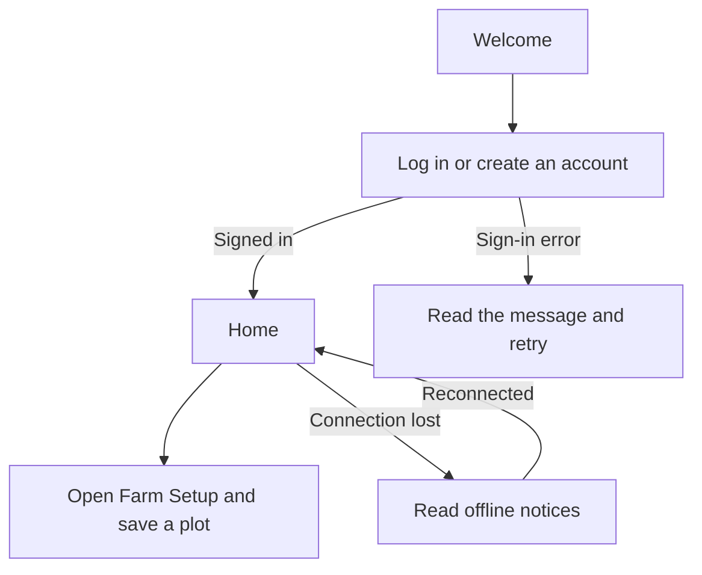

# Using Nila Shoshsho

Open the website in a supported browser. Use its install option when available. A browser can offer this under Install app or Add to Home Screen. Android and iPhone testers use their approved test build.

1. On Welcome, tap Create account or Log in.
2. Open Farm Setup to save a plot and Farm Monitoring to see your plots.
3. Open Market to check prices and their source date. Open Crop Care to check a leaf photo. An uncertain result gives you a next step.
4. For government support, open Schemes. Follow the official source to check availability and eligibility.
5. Open Notifications to check messages in the app.

If the connection drops, reopen the app and follow its offline notices. Reconnect before saving changes, signing in again or requesting fresh advice.

## Sign-in and reconnecting

