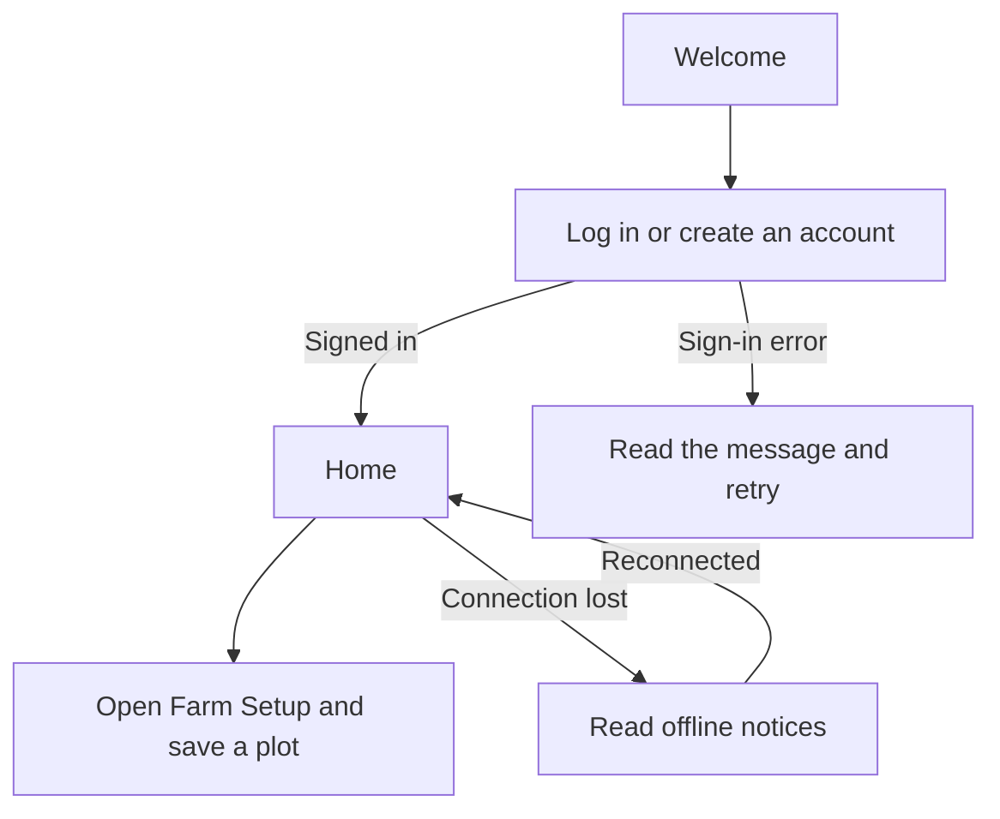

# Using Nila Shoshsho

Open the [Nila Shoshsho web beta](https://nila-shoshsho-pwa.vercel.app/) in your browser. On Welcome, tap **Create account** for a new account or **Log in** if you already have one. You can use the website in your browser. If your browser offers **Install app** or **Add to Home Screen**, use that option to open it from your device’s home screen later.

1. Open **Farm Setup** to save a plot and **Farm Monitoring** to see your plots.
2. Use **Ask Nila** for a crop question. If you speak the question, read the transcription before you send it.
3. Check the source and date on market information. Some government market data and schemes need credentials that are still pending. Follow the official source for availability and eligibility.
4. Open **Notifications** to check messages in the app.

Open the website online once before relying on offline startup. If the connection drops, reopen the app and follow its offline notices. Reconnect before saving changes, signing in again, or requesting fresh advice. If a request times out after the site has been idle, wait a minute and retry once.

For beta feedback, use the contact supplied with your invitation. Include the screen name, what you tapped, and any error message. Keep passwords, ID numbers, and private documents out of feedback. Plant photo results are awaiting review. Check crop treatment decisions with a qualified agricultural adviser.

## Sign-in and reconnecting

